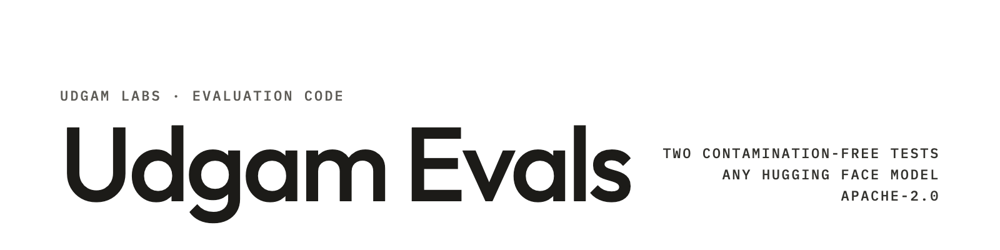

**UDGAM LABS** · Evaluation code · Two contamination-free tests for small language models

# Udgam Evals

Two small tests for language models of roughly 50M to 400M parameters, and the code to score any Hugging Face causal
language model on them. At this size many public benchmarks sit close to chance, and their questions may have leaked
into training data. These two avoid both problems:

- **[Fresh Text, October 2026](https://huggingface.co/datasets/udgamlabs/fresh-text-2026-10):** 1,670 English
  documents written after 1 September 2026 (new Wikipedia articles and arXiv abstracts). The score is **bits per byte**:
  how well the model predicts text it cannot have seen.
- **[Udgam Probe Suite](https://huggingface.co/datasets/udgamlabs/udgam-probes):** 2,000 generated questions with one
  exact answer each, in 7 types (arithmetic, unit conversion, sequences, word problems, comparisons, syllogisms). The
  score is accuracy.

Each test takes two to five minutes per model on an Apple-silicon Mac.

[Fresh Text dataset](https://huggingface.co/datasets/udgamlabs/fresh-text-2026-10) ·
[Probe Suite dataset](https://huggingface.co/datasets/udgamlabs/udgam-probes) · [udgamlabs.com](https://udgamlabs.com)

## Results

Measured by Udgam Labs on 17 October 2026, Apple-silicon Mac (PyTorch, MPS, float32), with the code in this
repository. Fresh text: bits per byte on 1,670 documents, lower is better. Probes: accuracy on 2,000 items, higher is
better (chance 32.5%).

| Model | Parameters | Fresh text (bpb) ↓ | Probes (%) ↑ |
|---|---|---|---|
| SmolLM2-360M | 360M | **0.853** | 71.2 |
| Gargi-Base (Udgam Labs) | 384M | 0.916 | 69.2 |
| Udgam-384M-Base-4K (Udgam Labs) | 384M | 0.939 | 61.9 |
| SmolLM2-135M | 135M | 0.944 | 44.4 |
| Falcon-H1-Tiny-90M-Base | 90M | 0.981 | **74.4** |

- **Fresh text:** all 10 pairwise gaps are significant (paired bootstrap over documents; 95% intervals ±0.001 to
  ±0.003). The closest pair, Udgam-384M-Base-4K and SmolLM2-135M, is 0.0049 apart [0.0025, 0.0072]. The runs scored the
  1,695 documents of the first build; these values are recomputed from their per-document results for the 1,670
  published documents.
- **Probes:** 9 of 10 pairs differ significantly (paired bootstrap over items; 95% intervals ±2 to ±3 points). The
  exception is SmolLM2-360M against Gargi-Base: 1.95 points [−0.35, +4.15].
- The two tests rank models differently: the smallest model, Falcon-H1-Tiny-90M-Base, predicts fresh text worst but
  answers the most probe questions correctly.
- Scores by type and by source are on the dataset pages and in [`results/results.json`](results/results.json).
- Check: re-running both scorers on the published datasets on 21 October 2026 reproduced SmolLM2-135M's numbers.

## Get started

```bash
git clone https://github.com/udgamlabs/udgam-evals && cd udgam-evals
pip install -r requirements.txt

python fresh_text/score.py HuggingFaceTB/SmolLM2-135M --out results/runs/SmolLM2-135M.fresh.json
python probes/score.py     HuggingFaceTB/SmolLM2-135M --out results/runs/SmolLM2-135M.probes.json
python compare.py results/runs/SmolLM2-135M.fresh.json results/runs/OTHER-MODEL.fresh.json
```

Both scorers download their dataset from Hugging Face on first use, pick CUDA, Apple MPS or CPU automatically, and save
one record per document or item so that two models can be compared. Useful options: `--revision` (pin a model
commit), `--device`, `--dtype` (default float32), `--add-bos auto|yes|no`, `--trust-remote-code`, and `--data` /
`--items` to score a local file.

Tested with Python 3.12, PyTorch 2.14 and Transformers 5.19.

## How it works

| File | What it does |
|---|---|
| [`fresh_text/score.py`](fresh_text/score.py) | Bits per byte. Each document is scored on its own, starting from the model's BOS token if its tokenizer has one. Longer documents are read with a 2,048-token window that slides by 1,024 tokens, so every token is scored exactly once (the script checks this). Total bits ÷ total UTF-8 bytes, which makes models with different tokenizers comparable. |
| [`probes/score.py`](probes/score.py) | Accuracy. For each question, the log-probability of each choice after the prompt; the most likely choice is the model's answer. |
| [`compare.py`](compare.py) | Paired bootstrap: resamples the shared documents or items 4,000 times and reports the 95% interval of the difference between two models. If it excludes zero, the gap is unlikely to be luck. |
| [`fresh_text/build.py`](fresh_text/build.py) | Builds a fresh-text set from the public Wikipedia and arXiv APIs, then re-checks every Wikipedia page and drops pages deleted since or tagged by editors as suspected AI-generated text. |
| [`probes/generate.py`](probes/generate.py) | Generates probe questions. `--types core --per 100 --seed 2026` reproduces the published 2,000 items exactly. |

## Where it falls short

- **Two narrow tests.** Bits per byte on encyclopedia and abstract text, plus basic numeric and logical questions,
  in English. Neither measures chat quality, following instructions, knowledge, code or other languages.
- **Base models in mind.** Both tests score raw text likelihood with no chat template. Chat models can be scored the
  same way, but the numbers say little about how well they converse.
- **Freshness wears off.** Once published, the fresh text can enter future training data, and anyone can train on the
  probe generator's output. Compare only models trained before October 2026, or build a new set (a new month, a new
  seed).
- **Settings matter.** Context length, the BOS token and numeric precision change bits per byte; likelihood scoring
  can put a model below chance on a question type. Compare models only under the same settings.
- **Small models only so far.** We have measured five models between 90M and 384M parameters, two of them our own.
  We have not checked how either test behaves for much larger models.

More detail is on each dataset page.

## Reproduce our numbers

Revisions scored (the weights at each revision are the ones measured on 17 October 2026):

| Model | Revision |
|---|---|
| [HuggingFaceTB/SmolLM2-360M](https://huggingface.co/HuggingFaceTB/SmolLM2-360M) | `f8027fd0eaeea54caa13c31d31b9fdc459c38b49` |
| [udgamlabs/Gargi-Base](https://huggingface.co/udgamlabs/Gargi-Base) | `f65e9466b21e026b969fa171eb8f6240cd90049b` |
| [udgamlabs/Udgam-384M-Base-4K](https://huggingface.co/udgamlabs/Udgam-384M-Base-4K) | `403f6b9e58049f84dd0433018386beeb92957b65` |
| [HuggingFaceTB/SmolLM2-135M](https://huggingface.co/HuggingFaceTB/SmolLM2-135M) | `93efa2f097d58c2a74874c7e644dbc9b0cee75a2` |
| [tiiuae/Falcon-H1-Tiny-90M-Base](https://huggingface.co/tiiuae/Falcon-H1-Tiny-90M-Base) | `7994372e93b62822ae25f8bfb19f653649cea3a3` |

```bash
python fresh_text/score.py tiiuae/Falcon-H1-Tiny-90M-Base --revision 7994372e93b62822ae25f8bfb19f653649cea3a3 \
    --device mps --out results/runs/Falcon-H1-Tiny-90M-Base.fresh.json
```

Falcon-H1-Tiny-90M-Base's tokenizer has no BOS token, so it is scored without one.

## Licence

The code is Apache-2.0 (see [LICENSE](LICENSE)). The datasets have their own licences: Fresh Text is CC BY-SA 4.0
(Wikipedia rows) and CC0 1.0 (arXiv rows); the Probe Suite questions are CC BY 4.0.

## Citation

```bibtex
@misc{udgamlabs2026evals,
  title        = {Udgam Evals: contamination-free tests for small language models},
  author       = {Prasad, Jitesh K and {Udgam Labs}},
  year         = {2026},
  howpublished = {\url{https://github.com/udgamlabs/udgam-evals}}
}
```

---

**About Udgam Labs.** Udgam Labs is an independent AI research lab. We work from first principles: before we build, we understand why things work, whether we are training a model, fine-tuning one or applying AI to a new problem. Udgam (उद्गम) is Sanskrit for origin. [udgamlabs.com](https://udgamlabs.com)
